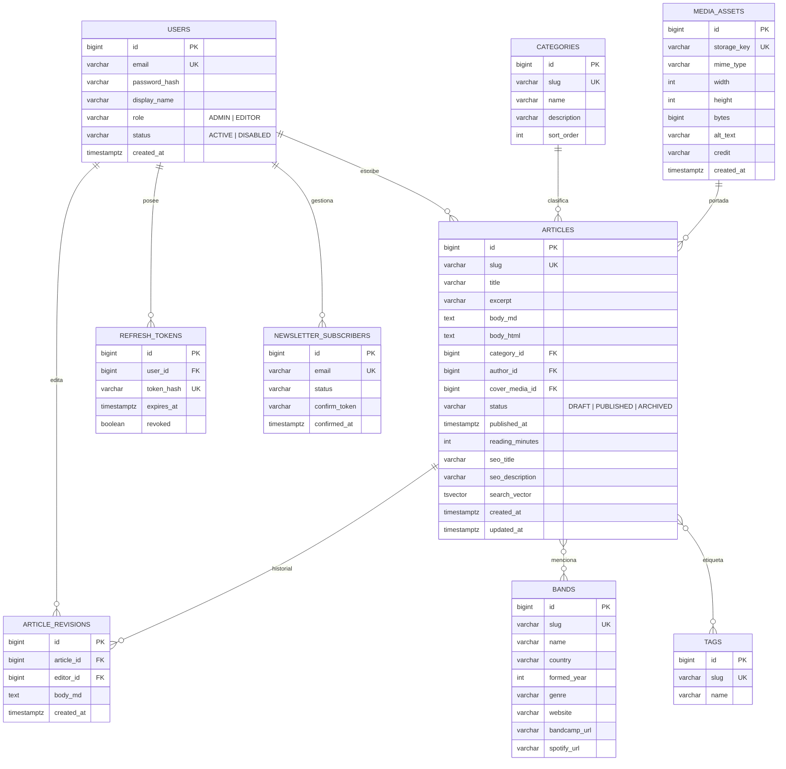

# Arquitectura — Portal de noticias de heavy metal

> Documento vivo. Versión 0.2 (M0 y M1 implementados y verificados).

## 1. Objetivo y alcance

Portal de noticias de heavy metal con publicación real y valor de portfolio. Dos usos:

1. **Público**: leer noticias por género, buscar, seguir bandas, suscribirse al RSS.
2. **Redacción**: un editor (tú) publica artículos; el modelo ya soporta más personal.

**Fuera del MVP** (diseñado, no construido): comentarios, newsletter con doble opt-in, multipublicación en redes.

**Criterio de éxito del MVP**: publicar 20 noticias reales, cargar en < 2,5 s en 4G, Lighthouse ≥ 95 en SEO y ≥ 90 en rendimiento, y estar indexado correctamente.

---

## 2. Stack

| Capa | Elección | Motivo |
|---|---|---|
| Lenguaje back | **Java 21.0.13 LTS** (Temurin) | LTS, records, pattern matching, virtual threads disponibles. |
| Framework back | **Spring Boot 3.5.16** | Última 3.x estable (la 4.x sigue en RC). Se sube a 4.x cuando MapStruct/springdoc estén alineados. |
| Persistencia | **PostgreSQL 17** | Búsqueda full-text nativa (`tsvector` + GIN), mejor free tier (Neon/Supabase) y estándar en ofertas Java. |
| Migraciones | **Flyway** | Sustituye `ddl-auto: update`. |
| Contrato | **OpenAPI 3.0 + openapi-generator (delegate)** | Se conserva tu patrón API-first. La 3.1 aún no está soportada por el generador elegido. |
| Mapeo | **MapStruct** | Se conserva. |
| Frontend | **Angular 22.2.6 + SSR** (Node 24 LTS) | Se conserva tu stack; SSR es obligatorio para SEO. |
| Estilos | **Tailwind 4** (PrimeNG se valorará para el admin de M2) | El sitio público no necesita una librería de componentes. |
| Tests back | JUnit 5, AssertJ, Mockito (Testcontainers en M4) | Unitarios rápidos ahora; integración real más adelante. |
| Tests front | Vitest/Jasmine + Playwright (e2e) | Unitarios + flujo crítico. |
| Infra | Docker multi-stage, Compose, GitHub Actions | Demostrable en el portfolio. |

---

## 3. Repositorios

**Dos repositorios independientes**, cada uno con su CI, su Dockerfile y su historial:

```
the-blast-beast-api/          # Spring Boot
├── src/main/java/com/theblastbeast/
├── src/main/resources/openapi/openapi.yaml
├── src/main/resources/db/migration/
├── Dockerfile
└── .github/workflows/api.yml

the-blast-beast-web/          # Angular + SSR
├── src/app/
├── Dockerfile
└── .github/workflows/web.yml
```

El `docker-compose.yml` de la raíz del workspace orquesta los dos para desarrollo local;
no se publica en ninguno de los dos repos.

Motivo: separación de responsabilidades y ciclos de despliegue, que es lo que encontrará
cualquier equipo real. Cada repo se puede clonar, construir y desplegar por separado.

---

## 4. Backend

### 4.1 Paquetes

```
com.theblastbeast
├── BlastBeastApplication.java
├── config/                 # Security, Web (converters), OpenAPI, CORS
├── properties/             # @ConfigurationProperties tipadas
├── controller/             # implementa *ApiDelegate (generado)
├── mapper/                 # MapStruct: entidad -> VO
├── service/                # ArticleService, CategoryService, BandService
├── repository/             # Spring Data + búsqueda full-text nativa
├── domain/
│   ├── entity/             # entidades JPA
│   └── vo/                 # generado por OpenAPI
└── exception/              # BusinessException, ErrorCode, GlobalExceptionHandler
```

**Cambio deliberado respecto al repo antiguo:** un servicio por agregado con métodos por caso de uso (`ArticleCommandService.publish`, `ArticleQueryService.findBySlug`) en lugar de interfaz+impl por operación. Con 40 clases para un CRUD el coste de navegación supera el beneficio. Se mantiene el patrón por operación cuando la operación es realmente compleja (p. ej. `PublishArticleService` con validaciones y eventos).

### 4.2 Convenciones

- Logging `INIT - Clase -> metodo()` / `END - Clase -> metodo()` (tu formato).
- Errores con `AppErrorCode` y `ProblemDetail` (RFC 9457) como cuerpo.
- `@ConfigurationProperties` + `@Validated` para toda configuración.
- `ddl-auto: validate`; esquema solo por Flyway.
- Entidades nunca en la capa web.
- Auditoría JPA (`@CreatedDate`, `@LastModifiedBy`).
- Transacciones en la capa de servicio, nunca en el controlador.

### 4.3 Modelo de datos



Notas:

- `search_vector` es columna generada (`to_tsvector('spanish', title || ' ' || excerpt || ' ' || body_html)`) con índice GIN. Búsqueda sin Elasticsearch.
- `article_revisions` da historial y deshacer: barato de implementar, muy visible en una demo.
- `article_bands` y `article_tags` son tablas puente M:N.
- Imágenes en object storage (Cloudflare R2); la BD solo guarda metadatos.

### 4.4 API (`/api/v1`)

**Público — implementado en M1:**

| Método | Ruta | Descripción |
|---|---|---|
| GET | `/articles` | Listado paginado; filtros `category`, `tag`, `band`, `q`, `sort`, `page`, `size` |
| GET | `/articles/featured` | Cinco noticias destacadas |
| GET | `/articles/{slug}` | Detalle; 404 si no existe o es borrador, 410 si archivado |
| GET | `/categories` | Categorías con conteo de publicados |
| GET | `/bands/{slug}` | Banda + noticias relacionadas |
| GET | `/search?q=` | Búsqueda full-text (mínimo 2 caracteres) |
| GET | `/ping` | Estado del servicio |

`sort` acepta `latest`, `oldest` y `relevance`. Los filtros se combinan entre sí. El listado
devuelve `content`, `page`, `size`, `totalElements`, `totalPages`, `first` y `last`.

**Redacción — diseñado para M2:**

| Método | Ruta | Auth | Descripción |
|---|---|---|---|
| POST | `/auth/login` | — | Access (JSON) + refresh (cookie HttpOnly) |
| POST | `/auth/refresh` | cookie | Rota el refresh token |
| POST | `/auth/logout` | cookie | Revoca |
| GET/POST/PATCH/DELETE | `/admin/articles…` | EDITOR | CRUD + `POST /admin/articles/{id}/publish` |
| POST | `/admin/media` | EDITOR | Multipart; genera 2 variantes WebP |
| GET/POST/PATCH | `/admin/bands`, `/admin/categories`, `/admin/tags` | EDITOR | Taxonomía |
| GET | `/admin/articles/{id}/revisions` | EDITOR | Historial |

**Entrega — M3:**

| Método | Ruta | Descripción |
|---|---|---|
| GET | `/feed.xml` | RSS 2.0 |
| GET | `/sitemap.xml` | Generado desde artículos publicados |
| GET | `/actuator/health` | Liveness/readiness |

El `openapi.yaml` es la fuente de verdad: genera los delegates del backend **y** el cliente TypeScript de Angular. Un solo contrato, cero DTOs duplicados a mano.

---

## 5. Frontend

### 5.1 Estructura

```
web/src/app/
├── core/
│   ├── api/          # modelos, ArticleApiService, API_BASE_URL
│   ├── seo/          # SeoService (title, meta, canonical, OG, JSON-LD), SITE_URL
│   ├── category-store.ts
│   └── format.ts
├── layout/           # header con buscador y secciones, footer
├── features/
│   ├── home/         # portada + resolver
│   ├── articles/     # tarjeta, archivo, detalle, resolvers
│   ├── bands/        # ficha de banda + resolver
│   ├── search/       # búsqueda + resolver
│   └── not-found/
├── app.routes.ts
└── app.routes.server.ts
```

- Rutas lazy por feature; `resolve` entrega los datos y `withComponentInputBinding()` los
  convierte en `input.required` del componente.
- `CategoryStore` se carga una vez con `provideAppInitializer` para la navegación global.
- Estado con **signals**; RxJS solo para HTTP y eventos.
- `OnPush` en todos los componentes.
- Interceptores previstos para M2: `authInterceptor` (token + refresh), `errorInterceptor`
  (ProblemDetail → toast), `loadingInterceptor` (barra global opcional).

### 5.2 SSR y SEO

- `@angular/ssr` con **`RenderMode.Server`** en todas las rutas: el contenido cambia con cada
  publicación y el prerender en build obligaría a tener la API levantada.
- `SeoService` aplica por ruta: `<title>`, `description`, `canonical`, Open Graph, Twitter Card
  y JSON-LD `NewsArticle`.
- Búsqueda, 404 y 410 llevan `noindex,follow` y no publican canonical.
- `RESPONSE_INIT` fija el status HTTP real (404/410) en la respuesta SSR.
- `SITE_BASE_URL` inyecta el origen público para canonical y OG; en el navegador se deduce
  de `location`.
- `<h1>` único, jerarquía de encabezados correcta, `alt` obligatorio (validado en el admin),
  `lang="es"`.

### 5.3 Diseño

- Tema oscuro por defecto, tokens en CSS (`--blood`, `--ink`, `--surface`, `--bone`, `--muted`).
- Tailwind 4 para todo el sitio público. PrimeNG, si entra, será solo para el admin de M2.
- Una sola tipografía de titular (condensada) + una de texto. Sin mezclar Bootstrap.

---

## 6. Contenido

- Editor **Markdown** en el admin con vista previa.
- El backend renderiza a HTML (`commonmark-java`) y **sanea** (OWASP Java HTML Sanitizer) antes de guardar `body_html`.
- El frontend muestra HTML ya renderizado: SSR rápido, sin librería de Markdown en el bundle.
- Autoguardado cada 20 s → `article_revisions`.
- Subida de imágenes: valida MIME real (no extensión), tamaño ≤ 10 MB, genera `thumb` (400 px) y `hero` (1200 px) en WebP.

---

## 7. Seguridad

- Access token JWT (15 min) en **memoria**; refresh token (7 días) en cookie `HttpOnly; Secure; SameSite=Strict`, hash SHA-256 en BD.
- Rotación de refresh token y revocación en logout.
- BCrypt (coste 12) para contraseñas.
- CORS cerrado al dominio del front; CSRF desactivado solo en endpoints sin cookie, activado en `/auth/*`.
- Rate limiting en login y en escritura (`bucket4j`).
- CSP, HSTS, `X-Content-Type-Options`, `Referrer-Policy`.
- Secretos por entorno; `gitleaks` en CI.
- Dependabot + GitHub Secret Scanning.

---

## 8. Infra y entrega

**Local**: `docker compose up` → Postgres + API + web SSR + Caddy. Datos de ejemplo por Flyway (`R__seed.sql`) en perfil `dev`.

**CI (GitHub Actions)**
- `api.yml`: `mvn -B verify` con Testcontainers + análisis + build de imagen.
- `web.yml`: `npm ci`, lint, test, build SSR, presupuesto de bundle.
- `deploy.yml` (tag `v*`): push a GHCR → SSH al VPS → `docker compose pull && up -d` → healthcheck → rollback si falla.

**Producción (escenario 1)**
- Hetzner CX22 (~4–5 €/mes) con Docker Compose y Caddy (TLS automático).
- Cloudflare delante (CDN + caché de estáticos).
- R2 para imágenes.
- `pg_dump` diario cifrado a R2, retención 14 días, restauración probada una vez al mes.
- Actuator + Uptime Kuma + alertas por email.
- Logs JSON a stdout; rotación de Docker.

---

## 9. Backlog priorizado

| Fase | Contenido | Estimación | Criterio de aceptación |
|---|---|---|---|
| **M0 Fundaciones** ✅ | Maven+Angular, Docker Compose, Flyway base, OpenAPI, CI, `/actuator/health` | 2–3 días | `docker compose up` deja el entorno listo; CI en verde en el primer push |
| **M1 Lectura** ✅ | Entidades, migraciones, endpoints públicos, home/listado/detalle/búsqueda, seed | 2 semanas | Contenido de ejemplo navegable con datos reales y filtros |
| **M2 Redacción** | Auth con roles, CRUD, editor Markdown, media, revisiones | 2 semanas | Publicar un artículo con portada e imágenes sin tocar la BD |
| **M3 SEO** | Sitemap, RSS, prerender selectivo, 404/410 ya en M1 | 1 semana | Rich Results válidos; sitemap enviado a Search Console |
| **M4 Calidad** | Testcontainers, cobertura, e2e Playwright, a11y AA, Lighthouse | 1 semana | Cobertura de servicios > 70 %, Lighthouse ≥ 90/95, 0 violaciones axe |
| **M5 Producción** | VPS, dominio, TLS, backups, monitorización, RGPD | 1 semana | Dominio real con HTTPS, backup restaurado con éxito |
| **M6 Crecimiento** | Newsletter doble opt-in, más roles, comentarios, relacionadas | según demanda | — |

Total MVP: **~250–350 h**.

---

## 10. Costes

| Concepto | Coste |
|---|---|
| Dominio `.com` | 10–15 €/año |
| VPS Hetzner CX22 | ~4–5 €/mes |
| Cloudflare R2 (imágenes) | 0 € hasta 10 GB |
| Cloudflare CDN/DNS | 0 € |
| Email transaccional (Brevo) | 0 € hasta 300/día |
| **Total** | **~6 €/mes + dominio** |

Arranque sin coste: Vercel/Cloudflare Pages + Neon + Render free (ya usas Railway/Render, así que te es familiar). Los free tiers no tienen backups serios: no metas contenido real sin exportar la BD.

---

## 11. Riesgos

| Riesgo | Mitigación |
|---|---|
| El SSR con prerender dinámico se complica | Empezar con `RenderMode.Server` + caché y optimizar después |
| Scope creep (comentarios, newsletter, foro) | M6 cerrado hasta publicar M5 |
| Contenido jurídico (fuentes, imágenes) | Citar siempre la fuente; imágenes propias o con licencia; aviso legal y privacidad desde M5 |
| Abandono por fatiga de proyecto largo | Publicar el sitio en M3, antes de M4/M5 |
